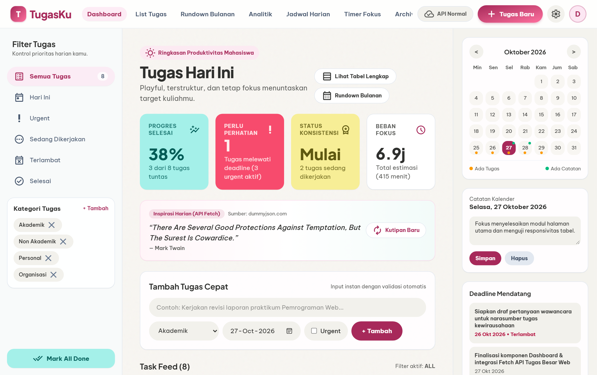
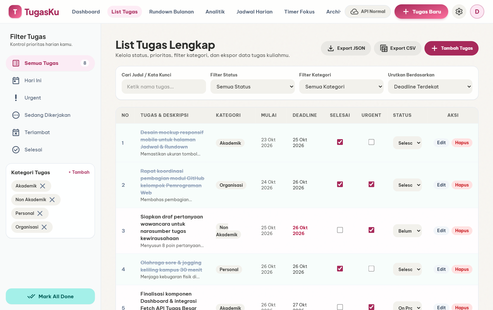
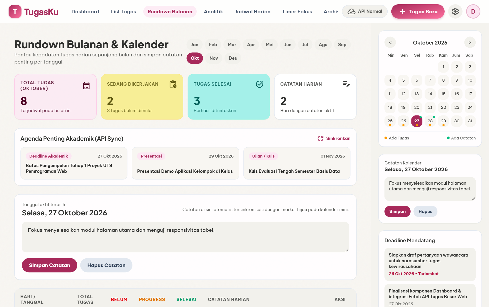
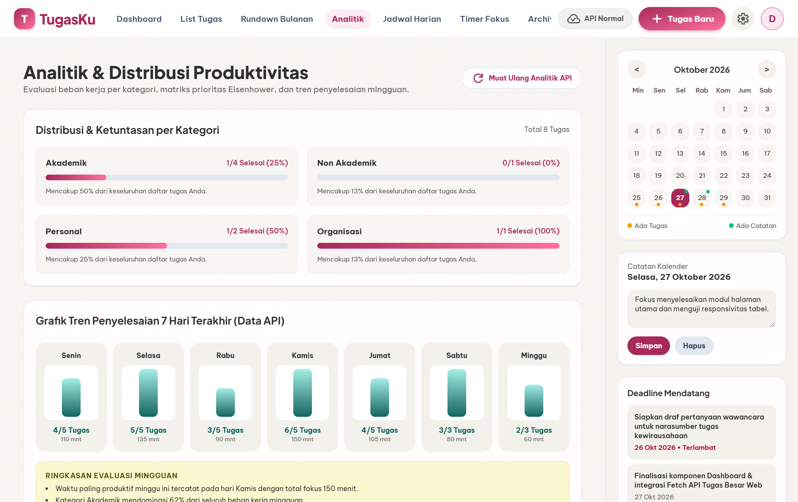
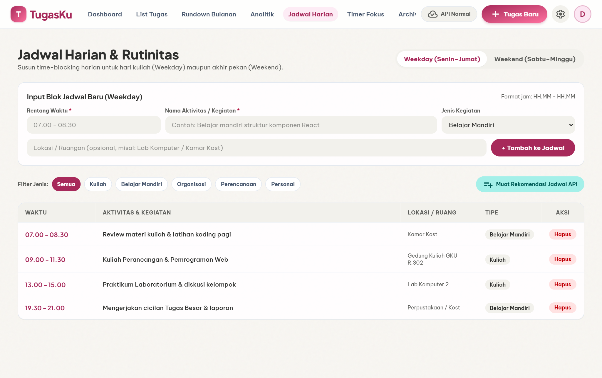
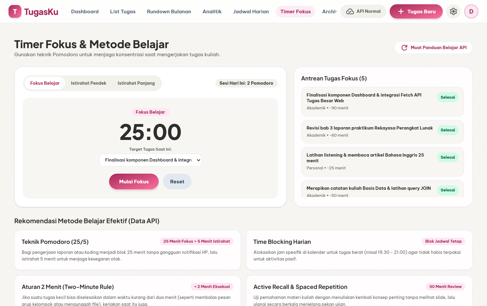
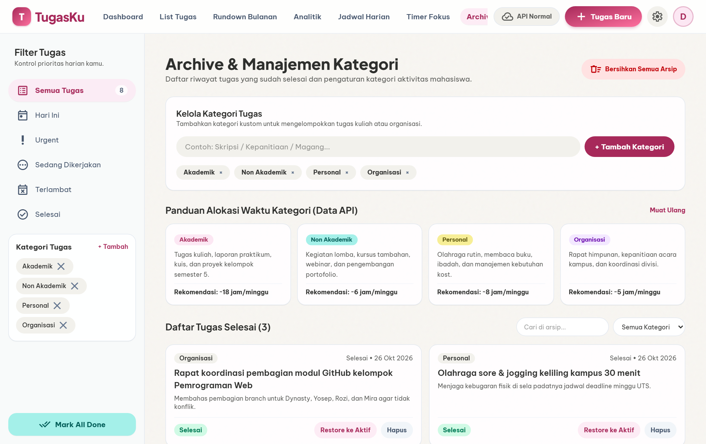
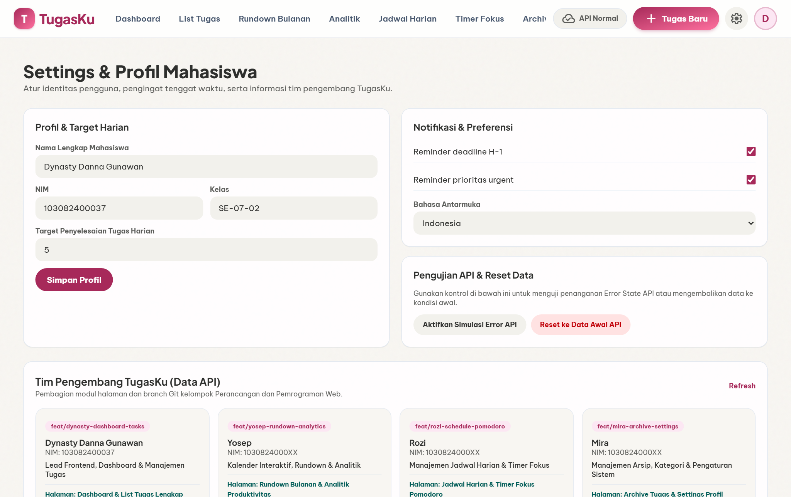
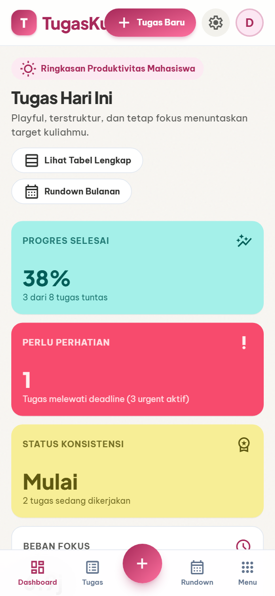
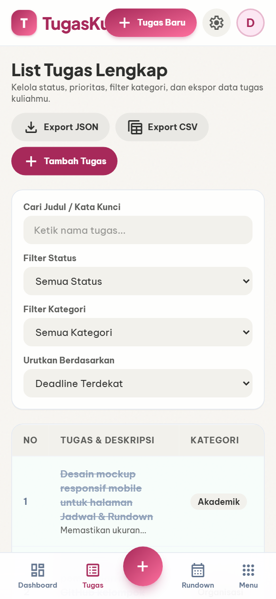

# TugasKu — Ruang Produktivitas & Manajemen Tugas Mahasiswa

> **Tugas Besar I (UTS) — Perancangan dan Pemrograman Web**  
> **Repository Proyek:** [https://github.com/dynastygunawan22/Tubes-PemWeb.git](https://github.com/dynastygunawan22/Tubes-PemWeb.git)

---

## 👥 Anggota Kelompok

| No | Nama Mahasiswa | NIM | Peran & Modul Halaman | Branch Git |
| :-: | :--- | :--- | :--- | :--- |
| **1** | **Dynasty Danna Gunawan** | `103082400037` | Lead Frontend, **Dashboard** & **List Tugas Lengkap** | `feat/dynasty-dashboard-tasks` |
| **2** | **Yosep** | `1030824000XX` | Kalender Interaktif, **Rundown Bulanan** & **Analitik** | `feat/yosep-rundown-analytics` |
| **3** | **Rozi** | `1030824000XX` | Manajemen Waktu, **Jadwal Harian** & **Timer Fokus** | `feat/rozi-schedule-pomodoro` |
| **4** | **Mira** | `1030824000XX` | Manajemen **Archive**, **Kategori** & **Settings Profil** | `feat/mira-archive-settings` |

---

## 💡 Deskripsi Aplikasi

**TugasKu** adalah aplikasi web produktivitas dan manajemen tugas terpadu yang dirancang khusus untuk mahasiswa dalam mengelola tenggat waktu perkuliahan, menyusun rundown aktivitas bulanan, mengatur blok waktu belajar harian (*time-blocking*), serta memantau konsistensi penyelesaian tugas.

Aplikasi ini merupakan pengembangan komprehensif dari purwarupa awal *TugasKu* menjadi aplikasi berbasis **React.js (Vite)** yang responsif, memenuhi standar *Web Accessibility (WAI-ARIA)*, menerapkan validasi formulir di sisi klien (*client-side validation*), serta mengonsumsi data dinamis melalui **Fetch API** dari *Mock API* dan *Public API* eksternal.

---

## 🛠️ Teknologi & Arsitektur (Tech Stack)

- **Frontend Framework:** React 19 (`useState`, `useEffect`, `useMemo`, `useCallback`, `useContext`, serta Custom Hooks `useFetchData`)
- **Build Tool & Bundler:** Vite 8
- **Styling & Layout:** Modern CSS3 (CSS Variables, **Flexbox**, **CSS Grid**, dan **7 Media Queries Breakpoints**) dikombinasikan dengan **Tailwind CSS v4**
- **HTTP Client & Data Source:**
  - Native **Fetch API** dengan `AbortController` timeout & simulasi latensi jaringan (`src/services/apiClient.js`)
  - **Public API Eksternal:** `https://dummyjson.com/quotes/random` (Kutipan motivasi produktivitas harian dengan *automatic local fallback*)
  - **Mock API Endpoints (`public/api/*.json`):**
    - `/api/tasks.json` & `/api/quotes.json`
    - `/api/rundown-notes.json` & `/api/analytics.json`
    - `/api/schedules.json` & `/api/study-tips.json`
    - `/api/categories.json` & `/api/profile-settings.json`
- **Accessibility & UX:** Semantic HTML5 (`<header>`, `<nav>`, `<main>`, `<aside>`, `<section>`, `<article>`, `<footer>`, `<time>`), *Skip-to-Content Link*, *Skeleton Loader*, dan *Comprehensive Error Retry State*.

---

## 🔗 Daftar Halaman yang Terkoneksi (8 Halaman)

1. **Dashboard (`/?page=dashboard`)** — Ringkasan 4 kartu metrik utama, kutipan produktivitas dari API, form *Tambah Tugas Cepat* bervalidasi, dan *Task Feed* interaktif.
2. **List Tugas Lengkap (`/?page=list-tugas`)** — Tabel manajemen tugas dengan pencarian *real-time*, filter multi-status & kategori, pengurutan (*sorting*), modal tambah/edit tugas, serta fitur **Export JSON & CSV**.
3. **Rundown Bulanan (`/?page=rundown-bulanan`)** — Navigasi 12 bulan, rekap tabel harian sebulan penuh, pencatatan agenda per tanggal, sinkronisasi agenda akademik dari API, dan kalender mini interaktif.
4. **Analitik Produktivitas (`/?page=analitik`)** — Visualisasi *progress bar* ketuntasan per kategori, grafik tren penyelesaian 7 hari terakhir dari API, serta matriks prioritas *Eisenhower*.
5. **Jadwal Harian (`/?page=jadwal-harian`)** — Pengaturan jadwal *Weekday (Senin–Jumat)* dan *Weekend (Sabtu–Minggu)*, validasi rentang jam, filter jenis kegiatan, dan pemuatan rekomendasi jadwal dari API.
6. **Timer Fokus Belajar (`/?page=fokus-timer`)** — Pengatur waktu *Pomodoro* (25/5/15 menit) yang terhubung dengan antrean tugas aktif serta panduan metode belajar dari API.
7. **Archive & Kategori (`/?page=archive`)** — Pengelolaan arsip tugas yang telah selesai (fitur *Restore ke Aktif* & *Bersihkan Arsip*) serta manajemen kategori tugas kustom.
8. **Settings & Profil (`/?page=settings`)** — Pengaturan profil mahasiswa, pengingat deadline H-1 & urgent, tombol simulasi uji *Error State API*, serta direktori anggota tim pengembang.

---

## 📁 Struktur Direktori Proyek

```text
Tubes-PemWeb/
├── public/
│   └── api/                        # Endpoint Mock API JSON
│       ├── tasks.json
│       ├── quotes.json
│       ├── rundown-notes.json
│       ├── analytics.json
│       ├── schedules.json
│       ├── study-tips.json
│       ├── categories.json
│       └── profile-settings.json
├── src/
│   ├── components/
│   │   ├── common/                 # Komponen UI Reusable (Skeleton, ErrorState, Toast, Modal)
│   │   ├── layout/                 # Kerangka Navigasi (Navbar, SidebarLeft, SidebarRight, Footer)
│   │   ├── rundown/                # Komponen Kalender Mini & Kartu Statistik Bulanan
│   │   ├── schedule/               # Komponen Form Jadwal & Widget Pomodoro
│   │   └── archive/                # Komponen Kartu Arsip & Manajemen Kategori
│   ├── context/
│   │   └── TugasKuContext.jsx      # State Management Terpusat (Context Provider)
│   ├── hooks/
│   │   └── useFetchData.js         # Custom Hook Fetch API (Loading, Error, Refetch)
│   ├── pages/                      # 8 Halaman Utama Aplikasi
│   ├── services/                   # Layer HTTP Client & Service API per Modul
│   ├── styles/                     # Stylesheet CSS Grid, Flexbox, & Media Queries
│   ├── utils/                      # Helper Tanggal, Validasi Form, & Ekspor File
│   ├── App.jsx
│   └── main.jsx
├── index.html
├── package.json
└── vite.config.js
```

---

## 🖼️ Tangkapan Layar Aplikasi (Screenshots)

### Tampilan Desktop
| Halaman Dashboard | Halaman List Tugas |
| :---: | :---: |
|  |  |

| Halaman Rundown Bulanan | Halaman Analitik Produktivitas |
| :---: | :---: |
|  |  |

| Halaman Jadwal Harian | Halaman Timer Fokus |
| :---: | :---: |
|  |  |

| Halaman Archive & Kategori | Halaman Settings & Profil |
| :---: | :---: |
|  |  |

### Tampilan Responsif Mobile
| Dashboard Mobile | List Tugas Mobile |
| :---: | :---: |
|  |  |

---

## 🚀 Instruksi Instalasi & Menjalankan Proyek (Setup Instructions)

Pastikan perangkat Anda telah terinstal **Node.js** (versi 18 ke atas) dan **Git**.

1. **Clone repository proyek:**
   ```bash
   git clone https://github.com/dynastygunawan22/Tubes-PemWeb.git
   cd Tubes-PemWeb
   ```

2. **Instal seluruh dependensi paket:**
   ```bash
   npm install
   ```

3. **Jalankan server pengembangan lokal (Development Mode):**
   ```bash
   npm run dev
   ```

4. **Akses aplikasi di browser:**
   Buka alamat `http://localhost:5173` pada peramban Anda.

5. **Membuat bundle produksi (Production Build):**
   ```bash
   npm run build
   npm run preview
   ```
